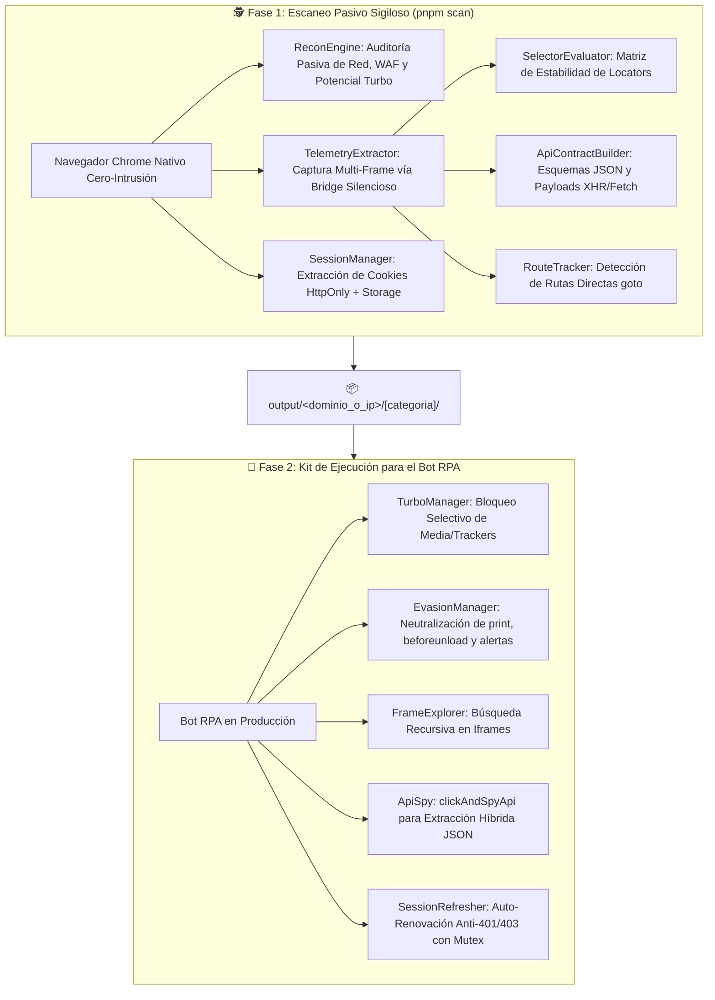

<div align="center">

# 🛡️⚡ scanner-kit-playwright

**Universal Web Reconnaissance, Reverse Engineering & RPA Blueprint Kit for Playwright & TypeScript**

*Motor de Descubrimiento Pasivo Sigiloso (Stealth Anti-WAF), Ingeniería Inversa de APIs y Kit de Automatización RPA Híbrido para Portales Corporativos y Sistemas ERP.*

[](https://www.typescriptlang.org/)
[](https://playwright.dev/)
[](https://opensource.org/licenses/MIT)
[](https://nodejs.org/)

</div>

---

## 📖 Filosofía y Propósito Principal

El objetivo principal de **`scanner-kit-playwright`** no es simplemente ejecutar clics sobre una página, sino **identificar, auditar y extraer todo el blueprint técnico necesario para construir una automatización RPA óptima**, separando claramente dos fases:

1. **🕵️ Fase 1: Observación Pasiva Cero-Intrusión (`pnpm scan` — Modo Sigiloso / Stealth):**
   - Abre una instancia genuina de Google Chrome (`channel: 'chrome'`) con su huella TLS/User-Agent real, **sin bloquear sub-recursos** y **sin alterar prototipos nativos del DOM (`addEventListener`, `window.print`)**.
   - Permite que el desarrollador interactúe con normalidad, supere validaciones **Cloudflare Turnstile / Bot Management / DataDome / Imperva / reCAPTCHA** sin ser detectado como bot, e inicie sesión en portales protegidos.
   - En segundo plano, audita pasivamente el tráfico HTTP/XHR/Fetch, los iframes anidados, las rutas SPA, los tokens de sesión y las interacciones de usuario.

2. **📐 Fase 2: Generación del Blueprint & Ejecución del Bot RPA (`output/<target>/`):**
   - Al finalizar la exploración, exporta 5 artefactos estructurados que revelan qué microservicios JSON pueden invocarse directamente (evitando automatizar calendarios o tablas complejas), qué selectores son estables, qué potencial de ahorro tiene el Modo Turbo y qué estrategia anti-WAF debe aplicar el bot en producción.

---

## 🏗️ Arquitectura de Módulos



---

## 🚀 Capacidades Principales

### 1. 🕵️ Modo Observador Pasivo Cero-Intrusión (Stealth Anti-WAF)
- Por defecto (`turboMode: false`, `evasionMode: false`), el escáner opera en modo **100% pasivo**:
  - Utiliza el canal oficial de Google Chrome (`channel: 'chrome'`) cuando se ejecuta en modo visual (`headless: false`), manteniendo intactos el `User-Agent`, el viewport nativo y la huella TLS/JA3.
  - Excluye automáticamente iframes de desafíos de seguridad (`challenges.cloudflare.com`, `recaptcha`, `hcaptcha`, `datadome`, `imperva`) de cualquier inyección de telemetría.
  - Comunica los eventos del DOM mediante un puente pasivo (`console.debug`) en lugar de inyectar bindings globales (`window.__scanner...`) ni sobrescribir `EventTarget.prototype.addEventListener`, evitando falsos positivos en WAFs modernos.

### 2. 📊 Blueprint de Optimización Pasiva (`optimizationBlueprint` en `recon-report.json`)
Durante tu navegación normal, `ReconEngine` calcula y diagnostica qué optimizaciones debes activar (o evitar) en tu bot final:
- **Potencial de Modo Turbo (`turboPotential`):** Cuantifica cuántas peticiones de imágenes, fuentes, multimedia y trackers se cargaron, calculando el porcentaje exacto de ahorro de red (`estimatedRequestSavingsPercent`) y recomendando si es seguro activar `turboMode: true` (`recommendedForBot`).
- **Detección de WAF / Anti-Bot (`antiBotWafDetected`):** Identifica automáticamente si el portal utiliza Cloudflare Turnstile, DataDome, Imperva o reCAPTCHA y documenta la estrategia RPA recomendada (ej. reutilización de `cf_clearance` y peticiones vía `page.request`).
- **Detección de Trampas UI (`uiTrapsDetected`):** Registra si la aplicación disparó diálogos nativos (`alert`, `confirm`, `prompt`) durante la sesión para que sepas si tu bot requiere `evasionMode: true`.

### 3. 📂 Agrupación Automática por Objetivo y Categoría (`output/<target>/[category]/`)
- Todos los artefactos generados se organizan automáticamente en subcarpetas limpias según el dominio o `IP_puerto` del portal escaneado:
  ```text
  output/
  ├── portal.ejemplo-corporativo.com/
  │   ├── session-backup.json       # Cookies (incl. HttpOnly/cf_clearance), localStorage y sessionStorage
  │   ├── recon-report.json         # Radiografía de red, tokens y optimizationBlueprint
  │   ├── execution-sequence.json   # Paso a paso cronológico de clics, inputs y rutas SPA
  │   ├── selectors-map.json        # Ranking de robustez de selectores (EXCELLENT a FRAGILE)
  │   └── api-contracts.json        # Contratos REST/XHR/Fetch con payloads y esquemas tipados
  └── 192.168.1.50_8080/
      └── facturacion/              # Subcarpeta opcional definida con TARGET_CATEGORY=facturacion
  ```

### 4. 📜 Ingeniería Inversa de Contratos API (`api-contracts.json`)
- Intercepta llamadas `XHR` y `fetch` asíncronas disparadas por tus acciones en la interfaz (incluso dentro de micro-frontends embebidos en iframes).
- Captura URL, query params, cabeceras de petición/respuesta, latencia en milisegundos, muestras reales de payload JSON/XML/FormData y **deduce automáticamente el esquema tipado (`requestSchema` y `responseSchema`)** para que puedas sustituir clics lentos de UI por llamadas HTTP directas.

### 5. 🛡️ Evaluador de Robustez de Selectores (`selectors-map.json`)
- Audita cada elemento con el que interactúas (tanto en el documento raíz como en iframes del mismo origen) y califica su estabilidad de `0` a `100`:
  - `EXCELLENT` (`95+`): Atributos dedicados de automatización (`data-testid`, `data-cy`, `data-qa`).
  - `HIGH` (`85-94`): IDs estáticos limpios, `aria-label`, roles semánticos o `name`/`placeholder` únicos.
  - `MEDIUM` (`60-84`): Texto visible (`page.getByText`) o combinaciones de clases de componentes UI.
  - `FRAGILE` (`<60`): Rutas CSS posicionales (`nth-of-type`) o XPaths estructurales profundos.

### 6. 🎬 Secuencia de Ejecución y Route Tracker (`execution-sequence.json`)
- Graba cronológicamente cada acción (`click`, `input` con contraseñas enmascaradas, `change`, `submit`, `navigate`) junto con el selector recomendado de Playwright y la ruta activa.
- Detecta vistas accesibles mediante navegación directa (`await page.goto(...)`) para saltar menús anidados.

### 7. ⚡ Módulos Activos para el Bot en Producción
Cuando pases de la fase de descubrimiento a programar tu bot RPA con `ScannerKit`, cuentas con:
- **`TurboManager` (`turboMode: true`):** Bloquea imágenes, fuentes, video y trackers conservando CSS y scripts para acelerar cargas en portales sin WAF estricto.
- **`EvasionManager` (`evasionMode: true`):** Anula `window.print()`, neutraliza bloqueos `beforeunload` y auto-resuelve diálogos nativos (`alert`/`confirm`).
- **`FrameExplorer` (`findElementAcrossFrames`):** Busca selectores recursivamente a través de múltiples niveles de `<iframe>`.
- **`ApiSpy` (`clickAndSpyApi<T>`):** Hace clic en un botón y captura concurrentemente la respuesta JSON del backend con tipado genérico.
- **`SessionManager` & `SessionRefresher`:** Exporta/restaura sesiones completas (`restoreSession`) y auto-renueva tokens ante errores `401`/`403` con bloqueo de concurrencia (Mutex).

---

## 📦 Instalación

```bash
# 1. Clonar el repositorio
git clone https://github.com/MSLegro/scanner-kit-playwright.git
cd scanner-kit-playwright

# 2. Instalar dependencias
pnpm install

# 3. Instalar navegadores de Playwright
npx playwright install chromium
```

---

## ⚙️ Configuración (`.env`)

Copia el archivo `.env.example` a `.env` en la raíz del proyecto:

```ini
# URL de la aplicación web o ERP que deseas escanear
# (Deja vacío para ejecutar la demo con el servidor ERP simulado local)
TARGET_URL=https://mi-portal-objetivo.com

# Modo visual interactivo (false = ventana abierta de Chrome, true = headless)
HEADLESS=false
INTERACTIVE=true

# Pausa entre acciones programáticas (0 recomendado para navegación manual fluida)
SLOW_MO=0

# Durante el escaneo (pnpm scan) se recomiendan en false para operar en
# Modo Observador Pasivo Cero-Intrusión (evita detección de Cloudflare Turnstile / WAF).
# El escáner medirá pasivamente el potencial de ahorro y lo reportará en recon-report.json.
TURBO_MODE=false
EVASION_MODE=false

# Auditoría pasiva de red y generación de blueprint
RECON_MODE=true

# Organización automática de artefactos: ./output/<dominio_o_ip>/[TARGET_CATEGORY]/
OUTPUT_DIR=./output
TARGET_CATEGORY=
```

---

## 🚀 Uso Rápido

### 1. Ejecutar un Escaneo de Descubrimiento (`pnpm scan`)

Puedes pasar la URL objetivo (y opcionalmente una categoría) directamente en el comando sin necesidad de editar el `.env`:

```bash
# Usando el flag --url= (o su versión corta --u=)
pnpm scan --url=https://mi-portal-objetivo.com/home

# Especificando además una subcarpeta/categoría (--category= o --cat=)
pnpm scan --u=https://mi-portal-objetivo.com/home --cat=autorizaciones

# O tomando TARGET_URL directamente desde tu archivo .env
pnpm scan
```

*(Soporta indistintamente `--url=`, `--u=`, `-u=`, `--category=`, `--cat=`, `--c=` o separados por espacio).*

**Flujo de trabajo recomendado:**
1. Se abrirá el navegador en **Modo Observador Pasivo Sigiloso**.
2. Inicia sesión normalmente (resuelve cualquier captcha si aparece), navega por los módulos, llena filtros y ejecuta las consultas que te interese automatizar.
3. Con la ventana del navegador aún abierta, presiona **`[ENTER]`** en la terminal.
4. Revisa la carpeta generada en `./output/<dominio_o_ip>/` con los 5 archivos JSON del blueprint.

---

### 2. Usar `ScannerKit` para Construir tu Bot RPA

Una vez analizado el blueprint en `./output/<target>/`, puedes construir tu bot combinando restauración de sesión, consumo de APIs en el contexto del navegador (`page.request`) o utilidades híbridas:

```typescript
import { ScannerKit } from 'scanner-kit-playwright';

async function runBot() {
  // 1. Inicializar según la recomendación de recon-report.json -> optimizationBlueprint
  const scanner = await ScannerKit.create({
    headless: false,
    turboMode: false,   // false si el portal tiene Cloudflare Turnstile; true en ERPs internos sin WAF
    evasionMode: false, // true si recon-report detectó trampas window.print() o alerts bloqueantes
    reconMode: true,
    outputDir: './output',
    targetCategory: 'ejecucion-bot'
  });

  // 2. Restaurar sesión previa (cookies cf_clearance, JSESSIONID, localStorage, sessionStorage)
  await scanner.goto('https://mi-portal-objetivo.com');
  await scanner.restoreSession('./output/mi-portal-objetivo.com/session-backup.json');
  await scanner.page.reload();

  // 3. Buscar elementos incluso si están dentro de iframes anidados
  const btnConsultar = await scanner.findElementAcrossFrames('#btn-consultar', {
    timeout: 5000,
    requireVisible: true
  });

  // 4. Espiar la respuesta JSON del backend al hacer clic
  const respuesta = await scanner.clickAndSpyApi<{ items: unknown[] }>(btnConsultar.locator, {
    urlPattern: '/api/v1/reportes',
    method: 'POST'
  });

  console.log(`Datos extraídos en ${respuesta.timingMs}ms:`, respuesta.data);

  // 5. Exportar todos los artefactos y cerrar
  await scanner.close();
}

runBot();
```

---

## 📚 Referencia de la API Principal (`ScannerKit`)

| Método | Argumentos | Retorno | Descripción |
| :--- | :--- | :--- | :--- |
| `ScannerKit.create(options?)` | `ScannerKitOptions` | `Promise<ScannerKit>` | Inicializa el navegador (Chrome nativo o Chromium), configura observación pasiva y módulos opcionales. |
| `scanner.goto(url, options?)` | `url: string`, `options?` | `Promise<Response \| null>` | Navega a la URL objetivo registrando la telemetría de carga inicial. |
| `scanner.findElementAcrossFrames(selector, options?)` | `selector: string`, `FindFrameOptions?` | `Promise<MultiFrameElementResult>` | Busca recursivamente un selector en el DOM principal y en todos los `<iframe>` hijos. |
| `scanner.clickAndSpyApi<T>(target, options?)` | `target: Locator \| string`, `ClickAndSpyOptions?` | `Promise<SpyResult<T>>` | Ejecuta el clic y captura en paralelo la respuesta XHR/Fetch correspondiente. |
| `scanner.exportAllArtifacts(outputDir?, category?)` | `outputDir?: string`, `category?: string` | `Promise<ExportArtifactsResult>` | Exporta los 5 archivos del blueprint dentro de `output/<target>/[category]/`. |
| `scanner.resolveTargetOutputDir(customDir?, customCategory?)` | `customDir?: string`, `customCategory?: string` | `string` | Resuelve y crea la ruta sanitizada del directorio de salida para el dominio/IP actual. |
| `scanner.exportSession(outputPath?)` | `outputPath?: string` | `Promise<SessionBackup>` | Extrae cookies, `localStorage` y `sessionStorage`. |
| `scanner.restoreSession(sessionInput)` | `string \| SessionBackup` | `Promise<void>` | Inyecta cookies y almacenamiento web desde un respaldo previo. |
| `scanner.generateReconReport(outputPath?)` | `outputPath?: string` | `ReconReport` | Genera el informe de red, tokens y `optimizationBlueprint`. |
| `scanner.close(options?)` | `{ exportArtifacts?: boolean }` | `Promise<void>` | Exporta artefactos pendientes (si `autoExportOnClose` está activo) y cierra el navegador. |

---

## 📂 Estructura del Proyecto

```text
scanner-kit-playwright/
├── .env.example                       # Plantilla segura de configuración
├── .gitignore                         # Protección estricta de .env y carpetas output/
├── LICENSE                            # Licencia MIT
├── package.json                       # Scripts y dependencias
├── tsconfig.json                      # Configuración TypeScript estricta
├── README.md                          # Documentación principal
└── src/
    ├── index.ts                       # Punto de entrada y exportaciones públicas
    ├── scanner-kit.ts                 # Orquestador principal ScannerKit
    ├── types/
    │   └── index.ts                   # Definiciones de tipos e interfaces TypeScript
    ├── modules/
    │   ├── recon-engine.ts            # Auditor pasivo de tráfico, WAF y potencial Turbo
    │   ├── telemetry-extractor.ts     # Captura multi-frame de eventos DOM y red sin huella JS
    │   ├── selector-evaluator.ts      # Algoritmo de puntuación y recomendación de Locators
    │   ├── api-contract-builder.ts    # Inferencia automática de esquemas y contratos XHR/Fetch
    │   ├── route-tracker.ts           # Detección de rutas SPA y sugerencias page.goto()
    │   ├── session-manager.ts         # Respaldo y restauración de cookies + Web Storage
    │   ├── session-refresher.ts       # Cliente HTTP con auto-relogin ante 401/403 y Mutex
    │   ├── frame-explorer.ts          # Buscador recursivo en iframes anidados
    │   ├── api-spy.ts                 # Captura reactiva clickAndSpyApi
    │   ├── turbo-manager.ts           # Bloqueo selectivo de recursos pesados para bots
    │   └── evasion-manager.ts         # Neutralización de print(), beforeunload y diálogos
    └── examples/
        ├── run-scan.ts                # CLI interactivo de escaneo y generación de blueprint
        ├── test-server.ts             # Servidor ERP local simulado para pruebas
        └── verify-e2e.ts              # Suite de verificación end-to-end automatizada
```

---

## 🛠️ Scripts Disponibles

- `pnpm scan`: Inicia el escáner en modo interactivo pasivo sobre la `TARGET_URL` configurada en `.env`.
- `pnpm verify`: Ejecuta la suite de verificación E2E contra el servidor local de prueba.
- `pnpm build`: Compila el proyecto TypeScript en `./dist` con declaraciones de tipos (`.d.ts`).
- `pnpm typecheck`: Verifica el tipado estático de todo el repositorio sin emitir archivos.

---

## 🔒 Seguridad y Privacidad de Datos

El archivo [`.gitignore`](.gitignore) está configurado para **bloquear la subida de cualquier dato sensible o artefacto de escaneo**:
- `.env` y `.env.*` (URLs privadas, credenciales o configuraciones locales).
- `output/`, `results/`, `session-backup.json`, `recon-report.json`, `execution-sequence.json`, `selectors-map.json` y `api-contracts.json` (cookies de sesión, tokens JWT, payloads o datos de negocio capturados durante los escaneos).

---

## 📄 Licencia

Distribuido bajo la Licencia **MIT**. Consulta el archivo [LICENSE](LICENSE) para más información.
