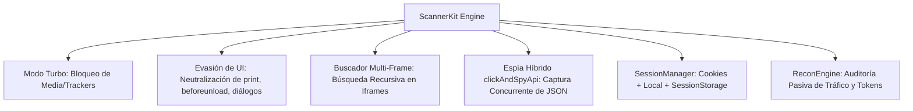

<div align="center">

# 🛡️⚡ scanner-kit-playwright

**Universal Web Reconnaissance, Reverse Engineering & Automation Kit for Playwright & TypeScript**

*Kit de Automatización RPA Híbrido, Ingeniería Inversa y Extracción de APIs para Aplicaciones Web Complejas y Sistemas ERP.*

[](https://www.typescriptlang.org/)
[](https://playwright.dev/)
[](https://opensource.org/licenses/MIT)
[](https://nodejs.org/)

</div>

---

## 📖 Descripción General

Automatizar portales corporativos pesados, sistemas ERP (SAP WebGUI/Fiori, Oracle PeopleSoft, Salesforce) y plataformas web complejas suele ser un reto frustrante debido a:
- Tiempos de carga lentos causados por megabytes de imágenes, banners y telemetría.
- Modales de impresión (`window.print()`) y trampas de salida (`beforeunload`) que congelan el hilo del navegador.
- Elementos ocultos dentro de múltiples niveles de `<iframe>` anidados.
- Scraping frágil de tablas HTML que cambian constantemente de selectores.
- Sesiones de usuario complejas repartidas entre cookies `HttpOnly`, `localStorage` y `sessionStorage`.

**`scanner-kit-playwright`** resuelve estos desafíos empaquetando Playwright con un motor de reconocimiento de bajo nivel, evasión de bloqueos nativos, navegación multi-frame y espionaje reactivo de APIs.

---

## 🚀 Capacidades Nativas



### 1. 🏎️ Modo Turbo (Rendimiento Extremo)
- Interceptación a nivel de red con `context.route()`.
- Bloquea recursos pesados (`image`, `media`, `font`) y trackers conocidos (`Google Analytics`, `Hotjar`, etc.).
- **Preserva intactos los estilos CSS (`stylesheet`) y scripts**, asegurando que los selectores de visibilidad (`:visible`, geometrías de layout) sigan funcionando de forma determinista.

### 2. 🥷 Evasión de UI & Neutralización
- Inyección ultra-temprana con `context.addInitScript()`:
  - Anula `window.print()`, reemplazándolo por un stub silencioso para evitar congelar el navegador al generar facturas o reportes.
  - Neutraliza trampas de salida `onbeforeunload` y oyentes bloqueantes de navegación.
- Auto-resolución inteligente de diálogos nativos (`page.on('dialog')`), evitando deadlocks en `alert()`, `confirm()` y `prompt()`.

### 3. 🔍 Buscador Multi-Frame Inteligente
- Método `findElementAcrossFrames(selector, options)`.
- Rastrea elementos recorriendo automáticamente el DOM principal y **cualquier `<iframe>` anidado activo**, sin importar la profundidad arquitectónica.

### 4. 🎯 El Espía de Botones Híbrido (`clickAndSpyApi`)
- Ejecuta el clic sobre un elemento visual y **simultáneamente atrapa la respuesta de red (XHR/Fetch)** mediante `Promise.all` y `waitForResponse`.
- Devuelve el JSON puro del backend con tipado TypeScript (`<T>`), cabeceras HTTP y latencia exacta en milisegundos (`timingMs`), eliminando la fragilidad del web scraping tradicional.

### 5. 💾 Exportador de Sesión Completa
- Empaqueta en un único archivo JSON:
  - Cookies del navegador (incluyendo atributos `HttpOnly`, `Secure` y `SameSite`).
  - Almacenamiento local (`localStorage`).
  - Almacenamiento de sesión (`sessionStorage`).
- Permite reanudar sesiones con `restoreSession()`, evitando repetir autenticaciones manuales o pasos 2FA.

### 6. 📡 Radiografía Técnica Pasiva (`recon-report.json`)
- Escucha pasivamente todo el tráfico HTTP durante la navegación automatizada o manual asistida.
- Clasifica endpoints REST y microservicios (métodos, query params, status codes, content-types y payloads de muestra).
- Identifica y enmascara tokens de seguridad (`Bearer JWT`, `Basic`, `X-CSRF-Token`, `API-Key`).

---

## 📦 Instalación

```bash
# 1. Clonar el repositorio
git clone https://github.com/MSLegro/scanner-kit-playwright.git
cd scanner-kit-playwright

# 2. Instalar dependencias con pnpm (o npm)
pnpm install

# 3. Descargar el navegador Chromium para Playwright
npx playwright install chromium
```

---

## ⚙️ Configuración Rápida (`.env`)

Crea un archivo `.env` en la raíz (puedes basarte en `.env.example`):

```ini
# ===============================================================
# Configuración de ScannerKit Playwright (.env)
# ===============================================================

# URL de la web o ERP que deseas auditar
# (Deja vacío si deseas usar el servidor local de prueba)
TARGET_URL=https://tu-sistema-erp.com

# Modo de ejecución (false = ventana visual abierta, true = modo headless)
HEADLESS=false

# Modo Interactivo:
# true = Mantiene el navegador abierto para explorar y loguearte manualmente.
#        Al terminar tu flujo, presiona [ENTER] en la terminal o cierra la ventana.
INTERACTIVE=true

# Pausa visual en ms entre acciones de Playwright
SLOW_MO=300

# Activar o desactivar módulos del kit
TURBO_MODE=true
EVASION_MODE=true
RECON_MODE=true

# Rutas de destino para los artefactos exportados
SESSION_BACKUP_PATH=./session-backup.json
RECON_REPORT_PATH=./recon-report.json
```

---

## 🚀 Uso Rápido

### Modo 1: Escaneo Interactivo desde la Terminal

Configura tu `.env` y ejecuta:

```bash
pnpm scan
```

O pásale la URL directamente por argumento CLI para sobreescribir el `.env`:

```bash
pnpm scan https://mi-portal-corporativo.com
```

> **¿Qué ocurre durante el escaneo interactivo?**
> 1. Se abre el navegador con Turbo y Evasión activados.
> 2. Puedes interactuar libremente: loguearte, explorar menús, abrir modales o hacer transacciones.
> 3. En segundo plano, ReconEngine cataloga cada petición, API y token en tránsito.
> 4. Al terminar tu flujo, presiona **`[ENTER]`** en la terminal o cierra la ventana.
> 5. Se generarán automáticamente `session-backup.json` y `recon-report.json`.

---

### Modo 2: En tus Propios Scripts de Automatización (RPA Híbrido)

Puedes importar y usar `ScannerKit` directamente en tus proyectos TypeScript:

```typescript
import { ScannerKit } from 'scanner-kit-playwright';

async function main() {
  // 1. Inicializar el kit
  const scanner = await ScannerKit.create({
    headless: false,
    turboMode: true,
    evasionMode: true,
    reconMode: true
  });

  // 2. Navegar a la aplicación
  await scanner.goto('https://mi-erp.empresa.com');

  // 3. Localizar elementos dentro de cualquier iframe anidado
  const botonReporte = await scanner.findElementAcrossFrames('#btn-generar-reporte', {
    timeout: 5000,
    requireVisible: true
  });
  console.log(`Elemento encontrado en iframe: ${botonReporte.isInIframe}`);

  // 4. Espiar la API del backend al hacer clic
  interface ReporteResponse {
    status: string;
    totalFacturas: number;
    datos: Array<{ id: string; monto: number }>;
  }

  const resultado = await scanner.clickAndSpyApi<ReporteResponse>(botonReporte.locator, {
    urlPattern: '/api/v1/reportes',
    method: 'GET',
    timeout: 10000
  });

  console.log(`✓ API respondida en ${resultado.timingMs}ms con Status ${resultado.status}`);
  console.log('Facturas recibidas:', resultado.data.datos);

  // 5. Exportar la sesión completa para futuros scripts
  await scanner.exportSession('./session-backup.json');

  // 6. Generar el reporte de reconocimiento técnico
  scanner.generateReconReport('./recon-report.json');

  await scanner.close();
}

main();
```

---

## 🔄 Reutilización de Sesión (Bypass de Login)

Una vez que exportaste tu sesión en `session-backup.json`, puedes reanudarla en cualquier script posterior **sin tener que volver a iniciar sesión**:

```typescript
import { ScannerKit } from 'scanner-kit-playwright';

async function automatizacionSinLogin() {
  const scanner = await ScannerKit.create({ headless: false });

  // Navegar a la página y restaurar cookies y storage guardados
  await scanner.goto('https://mi-erp.empresa.com');
  await scanner.restoreSession('./session-backup.json');

  // Recargar la página: ¡ya estarás autenticado en el panel!
  await scanner.page.reload();
  console.log('✓ Sesión restaurada exitosamente.');
  
  // Realizar acciones directas sin pasar por el formulario de login...
  await scanner.close();
}
```

---

## 📚 Referencia de la API

### `ScannerKit`

| Método | Argumentos | Retorno | Descripción |
| :--- | :--- | :--- | :--- |
| `ScannerKit.create(options?)` | `ScannerKitOptions` | `Promise<ScannerKit>` | Factoría estática que instancia Chromium, BrowserContext y aplica las capas de Turbo, Evasión y Recon. |
| `scanner.goto(url, options?)` | `url: string`, `options?` | `Promise<Response>` | Navega a una URL con esperas optimizadas para portales pesados. |
| `scanner.findElementAcrossFrames(selector, options?)` | `selector: string`, `FindFrameOptions?` | `Promise<MultiFrameElementResult>` | Busca recursivamente en el DOM raíz y en todos los iframes activos. |
| `scanner.clickAndSpyApi<T>(target, options?)` | `target: Locator \| string`, `ClickAndSpyOptions?` | `Promise<SpyResult<T>>` | Hace clic y atrapa la respuesta XHR/Fetch de backend con tipado genérico. |
| `scanner.exportSession(outputPath?)` | `outputPath?: string` | `Promise<SessionBackup>` | Empaqueta cookies, `localStorage` y `sessionStorage`. |
| `scanner.restoreSession(sessionInput)` | `string \| SessionBackup` | `Promise<void>` | Inyecta cookies y storage previamente exportados. |
| `scanner.generateReconReport(outputPath?)` | `outputPath?: string` | `ReconReport` | Genera la radiografía técnica y catálogo de APIs auditadas. |
| `scanner.newPage()` | Ninguno | `Promise<Page>` | Crea una nueva pestaña heredando listeners de evasión y telemetría. |
| `scanner.close()` | Ninguno | `Promise<void>` | Cierra limpiamente página, contexto y navegador. |

---

## 📂 Estructura del Repositorio

```
scanner-kit-playwright/
├── .env.example                 # Plantilla de variables de entorno
├── .gitignore                   # Protección de credenciales y artefactos generados
├── LICENSE                      # Licencia MIT
├── package.json                 # Scripts y dependencias del paquete
├── tsconfig.json                # Configuración TypeScript ES2022 estricta
├── README.md                    # Documentación técnica completa
├── src/
│   ├── index.ts                 # Punto de entrada y re-exports de la librería
│   ├── scanner-kit.ts           # Clase principal orquestadora
│   ├── types/
│   │   └── index.ts             # Interfaces y tipado TypeScript estricto
│   ├── modules/
│   │   ├── turbo-manager.ts     # Modo Turbo (bloqueo selectivo de recursos pesados)
│   │   ├── evasion-manager.ts   # Evasión de UI (print, beforeunload, diálogos)
│   │   ├── frame-explorer.ts    # Explorador Multi-Frame para iframes anidados
│   │   ├── api-spy.ts           # Espía reactivo de APIs backend (clickAndSpyApi)
│   │   ├── session-manager.ts   # Exportación e importación integral de sesión
│   │   └── recon-engine.ts      # Auditor pasivo de red y clasificador de tokens
│   └── examples/
│       ├── test-server.ts       # Servidor HTTP local de prueba (ERP simulado)
│       └── run-scan.ts          # Script ejecutable de escaneo y demostración
└── dist/                        # Código compilado listo para producción
```

---

## 🛠️ Comandos Disponibles

- `pnpm scan`: Ejecuta el escáner de reconocimiento según la configuración de `.env`.
- `pnpm build`: Compila los archivos TypeScript a JavaScript en `./dist` con archivos `.d.ts`.
- `pnpm typecheck`: Valida los tipos TypeScript en modo estricto sin emitir código.

---

## 🤝 Contribuciones

Las contribuciones son bienvenidas:
1. Haz un Fork del repositorio.
2. Crea una rama para tu feature (`git checkout -b feature/nueva-capacidad`).
3. Confirma tus cambios (`git commit -m 'feat: añadir soporte para X'`).
4. Sube la rama (`git push origin feature/nueva-capacidad`).
5. Abre un Pull Request.

---

## 📄 Licencia

Este proyecto está bajo la Licencia **MIT**. Consulta el archivo [LICENSE](LICENSE) para más detalles.
